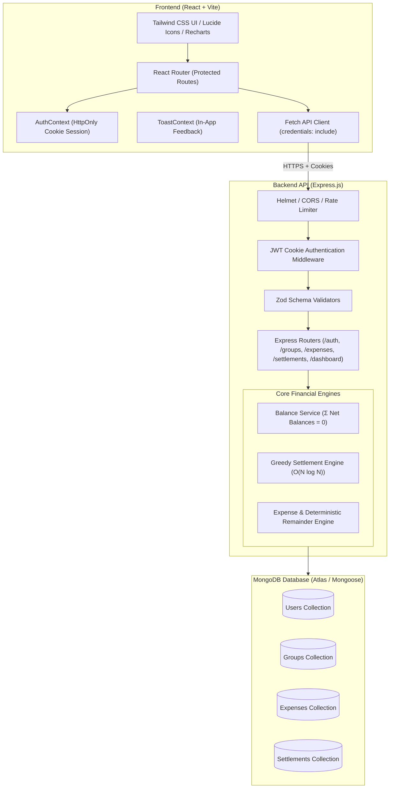

# SplitSmart

> **Shared expenses. Clear balances. Fair settlements.**

SplitSmart is a full-stack financial productivity web application built for students, roommates, and friends sharing travel or living expenses. It centralizes shared payments, calculates individual financial shares, provides a real-time balance ledger with mathematical conservation guarantees, and calculates an optimal, low-transaction settlement plan using an \(O(N \log N)\) greedy debt-matching algorithm.

---

## 1. Problem Statement

When friends travel together, students share accommodation, or roommates split utilities and groceries, one person typically pays on behalf of several people. Manually calculating who owes what becomes rapidly confusing when:
- Different people pay for different activities.
- Certain expenses involve only a subset of the group.
- Multiple currencies or fractional paisa/cents lead to IEEE 754 floating-point drift.
- Uncoordinated settlements create redundant circular transactions (e.g., A pays B while B pays C).

**SplitSmart** eliminates manual math and awkward conversations by recording shared transactions, maintaining an immutable balance ledger, and generating the minimum practical set of repayments needed to settle all debts.

---

## 2. Target Users

- **Friends on vacation or group road trips** (splitting hotels, fuel, tickets, dinners).
- **Roommates sharing an apartment** (splitting rent, utilities, household groceries, internet).
- **College students sharing meals and study project supplies**.
- **Organizers of events and parties**.

---

## 3. Technology Stack

### Frontend
- **React 18** with **Vite** (JavaScript, JSX).
- **Tailwind CSS** for modern, responsive UI design.
- **Lucide React** for clean, consistent iconography.
- **Recharts** for category spending visual charts.
- **React Router 6** for single-page client routing and route protection.
- **Context API** (`AuthContext`, `ToastContext`) for authentication state and non-blocking toast notifications.
- **Fetch API** with credentialed cookie support.

### Backend
- **Node.js** & **Express.js**.
- **MongoDB Atlas** with **Mongoose** (with in-memory test database support).
- **JWT (JSON Web Tokens)** stored in secure, `HttpOnly` cookies.
- **bcryptjs** for salted password hashing.
- **Zod** for schema validation.
- **Helmet**, credentialed **CORS**, and **express-rate-limit** for API security.

### Testing
- **Vitest** & **React Testing Library** for frontend component and utility tests.
- **Jest**, **Supertest**, and **mongodb-memory-server** for backend service and end-to-end API integration tests.

---

## 4. Architecture & System Design



---

## 5. Core Financial Engines & Business Logic

### A. Integer Minor Currency Units
To eliminate IEEE-754 floating-point inaccuracies, all financial calculations and database fields operate strictly in **integer minor currency units** (paise for INR, cents for USD/EUR):
$$\text{Minor Units} = \text{round}(\text{Major Amount} \times 100)$$

### B. Deterministic Remainder Distribution
When splitting an expense equally that leaves a non-zero remainder (e.g., ₹100 / 3 people = 10,000 paise / 3):
- Base share: $\lfloor 10000 / 3 \rfloor = 3333$ paise (₹33.33).
- Remainder: $10000 \pmod 3 = 1$ paisa.
- The remainder is allocated 1 minor unit at a time to participants ordered lexicographically by participant ID.
- Result: Person 1 gets ₹33.34, Person 2 gets ₹33.33, Person 3 gets ₹33.33. Sum is **exactly** ₹100.00.

### C. Balance Calculation Sign Convention
For each member in a group:
$$\text{Net Balance} = (\text{Total Paid} - \text{Total Assigned Shares}) + (\text{Settlements Paid} - \text{Settlements Received})$$

- **Positive Net Balance ($> 0$):** The group owes money to the user (Creditor).
- **Negative Net Balance ($< 0$):** The user owes money to the group (Debtor).
- **Zero Net Balance ($= 0$):** The user is fully settled.
- **Mathematical Invariant:**
$$\sum_{i=1}^N \text{Net Balance}_i = 0$$
SplitSmart programmatically validates this invariant on every calculation.

### D. Settlement Optimization Algorithm
SplitSmart uses a greedy debt-matching heuristic:
1. Divide members into **Debtors** ($\text{net} < 0$) and **Creditors** ($\text{net} > 0$).
2. Sort debtors descending by amount owed and creditors descending by amount receivable.
3. In each iteration, transfer:
$$T = \min(\text{debtor.amountOwed}, \text{creditor.amountReceivable})$$
4. Decrement both amounts by $T$ and advance pointers when an individual balance reaches zero.
5. Produces at most $N - 1$ total transfers in $O(N \log N)$ time complexity.

*Limitation note:* While finding the absolute minimum transactions across arbitrary subsets is an NP-hard problem equivalent to Subset Sum, this greedy heuristic is computationally efficient, deterministic, produces at most $N-1$ payments, and is standard in split applications.

### E. Financial Audit Protection Rule
Once a settlement repayment has been recorded in a group, historical expenses cannot be edited or deleted. Modifying past expenses after settlement receipts have already been issued would invalidate existing repayment receipts and distort audit history.

---

## 6. Database Models (MongoDB Atlas)

- **User**: `name`, `email` (normalized, unique), `password` (bcrypt hashed), `createdAt`.
- **Group**: `name`, `description`, `type` (`Trip`, `Home`, `Event`, `Other`), `currency` (e.g. `INR`), `creator` (ref User), `members` (refs User).
- **Expense**: `group`, `title`, `amountMinor`, `currency`, `category`, `paidBy` (ref User), `participants` (`[{ user, shareMinor }]`), `splitMethod` (`EQUAL`, `EXACT`, `PERCENTAGE`), `expenseDate`, `notes`, `createdBy`.
- **Settlement**: `group`, `payer` (ref User), `recipient` (ref User), `amountMinor`, `currency`, `status` (`completed`, `pending`), `note`, `idempotencyKey` (sparse unique index), `completedAt`.

---

## 7. REST API Endpoints

| Method | Endpoint | Description | Auth Required |
|---|---|---|---|
| `GET` | `/api/health` | Health status and uptime | No |
| `POST` | `/api/auth/register` | Register new user | No |
| `POST` | `/api/auth/login` | Login and set HttpOnly JWT cookie | No |
| `POST` | `/api/auth/logout` | Logout and clear cookie | No |
| `GET` | `/api/auth/me` | Get authenticated user | Yes |
| `GET` | `/api/users/me` | Get user profile & group statistics | Yes |
| `PATCH` | `/api/users/me` | Update user display name | Yes |
| `GET` | `/api/dashboard` | Aggregated dashboard stats & charts | Yes |
| `POST` | `/api/groups` | Create group (with optional invitees) | Yes |
| `GET` | `/api/groups` | List groups the user belongs to | Yes |
| `GET` | `/api/groups/:groupId` | Get group details | Yes (Member) |
| `PATCH` | `/api/groups/:groupId` | Update group settings | Yes (Creator) |
| `DELETE` | `/api/groups/:groupId` | Delete empty group (0 expenses) | Yes (Creator) |
| `POST` | `/api/groups/:groupId/members` | Add registered user by email | Yes (Member) |
| `POST` | `/api/groups/:groupId/expenses` | Record new expense in group | Yes (Member) |
| `GET` | `/api/groups/:groupId/expenses` | List group expenses with filters | Yes (Member) |
| `GET` | `/api/expenses` | List all user expenses across groups | Yes |
| `GET` | `/api/expenses/:expenseId` | Get single expense details | Yes (Member) |
| `PATCH` | `/api/expenses/:expenseId` | Edit expense (if no settlements) | Yes (Member) |
| `DELETE` | `/api/expenses/:expenseId` | Delete expense (if no settlements) | Yes (Member) |
| `GET` | `/api/groups/:groupId/balances` | Calculate member balances | Yes (Member) |
| `GET` | `/api/groups/:groupId/settlement-plan` | Compute greedy settlement plan | Yes (Member) |
| `GET` | `/api/groups/:groupId/settlements` | List completed group settlements | Yes (Member) |
| `POST` | `/api/groups/:groupId/settlements` | Record debt repayment | Yes (Member) |
| `GET` | `/api/settlements` | List user settlements across groups | Yes |

---

## 8. Installation and Local Setup

### Prerequisites
- **Node.js** v18+ (tested on Node v20)
- **npm** v9+
- A **MongoDB Atlas** database connection string (or local MongoDB server)

### 1. Clone & Install Dependencies
```bash
# Clone the repository
git clone <repository-url>
cd splitsmart

# Install all dependencies for both backend and frontend
npm run install:all
```

### 2. Configure Environment Variables

**Backend (`backend/.env`):**
```env
PORT=5000
NODE_ENV=development
MONGODB_URI=mongodb+srv://<username>:<password>@cluster0.mongodb.net/splitsmart?retryWrites=true&w=majority
JWT_SECRET=your_secure_random_jwt_secret_key_here
CLIENT_URL=http://localhost:5173
```
*(If you do not have MongoDB Atlas running locally, `USE_IN_MEMORY_DB=true` can be set in `backend/.env` for rapid local demo testing without an external database).*

**Frontend (`frontend/.env`):**
```env
VITE_API_URL=/api
```

---

## 9. Running the Application

### Option A: Run Backend and Frontend Concurrently
From the root directory:
```bash
# Terminal 1: Start Backend (Port 5000)
npm run backend

# Terminal 2: Start Frontend (Port 5173)
npm run frontend
```
Open [http://localhost:5173](http://localhost:5173) in your browser.

---

## 10. Automated Tests

All tests run isolated with zero external database dependencies:

```bash
# Run all backend tests (44 tests in 4 suites: currency, balances, settlements, API)
npm run test:backend

# Run frontend tests (Vitest + React Testing Library)
npm run test:frontend

# Run both backend and frontend test suites
npm test
```

### Verified Test Results
- **Currency & Rounding Suite:** Divisibility, fractional remainders, exact splits, percentage splits, deterministic ordering.
- **Balance Calculation Suite:** 1 payer 3 participants, payer included in split, partial group splits, multi-expense aggregation, completed settlements update, invariant sum $= 0$.
- **Settlement Optimization Suite:** 1 debtor / 1 creditor, multiple debtors / 1 creditor, 1 debtor / multiple creditors, already settled groups, total debts $\neq$ total credits rejection.
- **API Integration Suite:** User registration, duplicate email rejection, JWT HttpOnly cookies, group permissions (403 for non-members), expense recording, idempotency key duplicate settlement prevention, 409 audit lock on expense deletion after settlements.


## 11. Security Considerations

- **HttpOnly Cookies:** Authentication tokens are stored in `HttpOnly` cookies, preventing XSS attacks from reading JWTs.
- **CSRF & SameSite:** Configured with `SameSite=lax` in local development and `SameSite=none; Secure` in HTTPS production.
- **Authorization & Ownership:** Group membership is strictly validated on the server side for every private route. User-supplied IDs in requests are never trusted.
- **Input Validation:** Zod schemas validate and sanitize all incoming request bodies and query parameters.
- **Audit Immutability:** Historical expenses cannot be altered once debts have been settled.
- **No Secrets in Repo:** Credentials and JWT secrets are kept exclusively in `.env` files.

---

## 13. AI Assistance Disclosure
In accordance with submission requirements, generative AI assistance was little utilized as an architectural pair programmer to design schema models, generate unit tests.Major code components is done by human software specifications.
